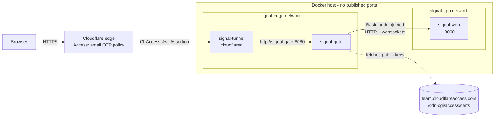

# signal-web-gate

Run [Signal Desktop](https://signal.org/download/) in a browser, privately, behind
Cloudflare Access **and** a second, self-hosted password page.

> **New to this? Start with the [step-by-step setup guide](https://vlsalsa.github.io/signal-web-gate/)**
> (also in this repo as [`docs/index.html`](docs/index.html), which you can open from a ZIP download).
> It assumes a fresh Mac or Windows PC and no coding experience, and uses the setup helpers
> below.

It is a small Docker Compose stack:

| Service | Image | Role |
|---|---|---|
| `signal-web` | [`lscr.io/linuxserver/signal`](https://docs.linuxserver.io/images/docker-signal/) | Signal Desktop in a web desktop, with its own internal HTTP basic auth |
| `signal-gate` | built from [`gate/`](gate/) | Go reverse proxy: verifies the Cloudflare Access JWT, then asks for a password |
| `signal-tunnel` | [`cloudflare/cloudflared`](https://hub.docker.com/r/cloudflare/cloudflared) | Outbound-only Cloudflare Tunnel; no published ports |

> Not affiliated with Signal, LinuxServer.io or Cloudflare. Running Signal Desktop
> on a server means your messages live on that server. Read [Caveats](#caveats).

## Architecture



- The tunnel is only on `signal-edge`, so it can reach the gate and never Signal directly.
- Signal is only on `signal-app`, so the gate is the only way in.
- The connector dials out to Cloudflare; nothing listens on your router or host.

Each request goes through these steps:
1. Cloudflare Access signs you in (email one-time PIN, or another IdP you allow).
2. The gate verifies the Access JWT itself: it does not trust Cloudflare headers blindly.
3. Without a valid gate session, it shows the password page. On success it sets a signed
   session cookie.
4. It strips Cloudflare and auth headers and cookies, injects the internal basic auth and
   proxies HTTP and websockets to `signal-web`.

## Requirements

- Docker Engine with the Compose v2 plugin, or Docker Desktop on macOS or Windows.
  The `signal-web` image is published for **x86-64 only** (`platform: linux/amd64`); on
  Apple-silicon Macs Docker Desktop runs it under Rosetta/QEMU emulation. The gate and
  `cloudflared` are pinned to multi-arch indexes (amd64 and arm64).
- A domain on Cloudflare, and a Cloudflare Zero Trust organization (the free plan works).
- `openssl` and `bash` for the helper scripts.

## Cloudflare setup

The dashboard moves things around; the names below are current as of late 2026.

1. **Turn on One-time PIN.** In Zero Trust go to **Integrations → Identity providers →
   Add new → One-time PIN** (plus any IdP you trust).
2. **Create an Access application first,** so the hostname is never public. Go to
   **Zero Trust → Access controls → Applications → Create new application → Self-hosted
   and private**, add the public hostname, e.g. `signal.example.com`, then:
   - **Policy:** action *Allow*, include *Emails* → only the address(es) you will allow.
   - **Login methods:** One-time PIN.
   - Set a session duration you're comfortable with.
3. **Copy the Application Audience (AUD) tag** (under the application's additional settings)
   into `GATE_AUD`.
4. **Find your team domain** under Zero Trust **Settings** (team name and domain), or in the
   Access login URL, e.g. `https://YOUR_TEAM.cloudflareaccess.com`. That's `GATE_TEAM`. It
   must match the token's `iss` exactly.
5. **Create a tunnel.** Go to **Networking → Tunnels → Create a tunnel → Cloudflared**.
   Name it, pick Docker, and copy only the **token** (the guided helper accepts the whole
   command). Don't run the suggested `docker run` command.
6. **Add a published application route** to the tunnel for the same hostname, with
   service `http://signal-gate:8080`.

Put the email addresses from the Access policy in `GATE_ALLOWED_EMAIL`. The gate enforces
them again, so a broadened Access policy alone does not let anyone in.

## Guided setup on a Mac or Windows PC (Docker Desktop)

After the [Cloudflare setup](#cloudflare-setup) above, run the helper from the repo folder:

| Platform | Run |
|---|---|
| macOS (or Linux) | `bash scripts/setup.sh` (or double-click `setup.command`) |
| Windows | double-click `setup.bat`, or `powershell -ExecutionPolicy Bypass -File .\scripts\setup.ps1` |

It checks Docker, asks for your hostname, team name, AUD tag and allowed emails, writes
`.env`, creates everything in `./secrets` (the tunnel token is read without echo and can be
pasted as the whole install command Cloudflare shows), builds the gate, hashes your password
with argon2id, starts the stack and waits for the gate's health check. It is safe to re-run.
`bash scripts/setup.sh password` / `setup.ps1 -ResetPassword` changes the password and
rotates the session key, which signs out every browser.

On Docker Desktop the helper sets `COMPOSE_FILE` in `.env` to add
[`compose.desktop.yml`](compose.desktop.yml). Docker Desktop runs containers in a VM, where
host `chown` has no effect, so that override keeps the Signal profile and gate state in
named volumes (the gate image pre-creates `/gate/state` as uid 3006). The secret files stay
in `./secrets`, a `0700` folder in your home directory, and are readable inside the VM.
Plain `docker compose ...` commands keep working because Compose reads `COMPOSE_FILE` from
`.env`. Note that `docker compose down -v` deletes those volumes and so the linked Signal profile.
Set `SIGNAL_SETUP_MODE=desktop` or `native` to override the helper's guess (for example on
Colima or Rancher Desktop).

## Quick start (Linux host, by hand)

`bash scripts/setup.sh` also works on a native Linux Docker host; it does the `chown` steps
below with `sudo`. To do it by hand:

```bash
git clone https://github.com/vlsalsa/signal-web-gate.git
cd signal-web-gate
cp .env.example .env          # fill in GATE_TEAM, GATE_AUD, GATE_ALLOWED_EMAIL, GATE_ORIGIN

# Secrets (all land in ./secrets, which is git-ignored).
./scripts/generate-session-key.sh
./scripts/generate-upstream-basic.sh signal      # same name as UPSTREAM_USER in .env
docker compose build signal-gate
./scripts/hash-password.sh                        # prompts twice, no echo
# Save your tunnel token (from step 1 above) without putting it in shell history:
read -rs TOKEN && printf '%s' "$TOKEN" > secrets/tunnel_token && unset TOKEN

# Ownership: the gate runs as 3006, cloudflared as 65532 (its image default) and
# signal-web as PUID/PGID (default 3005). Compose bind-mounts secret files with their host
# ownership, so each file must be readable only by the container that uses it.
mkdir -p config state
sudo chown 3006:3006 secrets/session_key secrets/upstream_basic secrets/gate_password.argon2 state
sudo chown 65532:65532 secrets/tunnel_token
sudo chown 0:0 secrets/upstream_password    # read by signal-web's init as root
sudo chmod 0400 secrets/*
sudo chown 3005:3005 config                 # match PUID/PGID

docker compose up -d
docker compose ps
```

Then open `https://signal.example.com`:
1. Complete the Cloudflare sign-in.
2. Enter your password on the dark **Signal** page.
3. Link Signal Desktop from your phone (**Settings → Linked devices**) using the QR code.

To change the password, delete `secrets/gate_password.argon2`, run `hash-password.sh`
again, fix ownership, and run `docker compose restart signal-gate`.

### Configuration

Every gate flag can also be set with a `GATE_*` environment variable. For example,
`-allowed-email` becomes `GATE_ALLOWED_EMAIL`. If both are set, the command-line flag wins.

| Flag / env | Meaning |
|---|---|
| `-team` / `GATE_TEAM` | Access team URL; must equal the JWT `iss` |
| `-aud` / `GATE_AUD` (or `-aud-file`) | Access application AUD tag |
| `-allowed-email` / `GATE_ALLOWED_EMAIL` | Allowed email, or a comma-separated list |
| `-origin` / `GATE_ORIGIN` | Public origin, e.g. `https://signal.example.com` (exact match) |
| `-upstream` / `GATE_UPSTREAM` | Upstream URL (default `http://signal-web:3000`) |
| `-password-file` | argon2id PHC string |
| `-session-key-file` | ≥32-byte HMAC key |
| `-upstream-basic-file` | `base64(user:pass)` for `signal-web` |
| `-state-dir` | Writable dir for lockout state |
| `-session-ttl` | Session lifetime (default `12h`) |
| `-cookie-samesite` | `lax` (default) or `strict` |
| `-hash-stdin` | Read a password on stdin, print an argon2id hash, and exit |
| `-verify-stdin FILE` | Check a password on stdin against a hash file |
| `-healthcheck` | Probe the local health endpoint (used by Compose) |

## Security model

- **Access JWT verification.**
  - The gate checks `Cf-Access-Jwt-Assertion` with **RS256 only** against the team's
    published keys, which it caches and refreshes on an unknown `kid`.
  - It checks `iss`, `aud`, `exp`, `nbf` and `iat` with 60 s skew, and the `email` claim
    against the allow-list.
  - It never trusts the plain `Cf-Access-Authenticated-User-Email` header.
  - If the keys can't be fetched, it fails closed.
- **Password.**
  - The password is stored only as an **argon2id** PHC hash (default m=64 MiB, t=3, p=1).
    Weak parameters are refused.
  - Checks are serialized, and each failure adds a fixed delay.
- **Lockout.**
  - 5 failures in 15 minutes locks login for 15 minutes.
  - 20 failures in 24 hours is a hard lock.
  - State persists in `state/`, so a restart doesn't reset it.
- **Sessions.**
  - An HMAC-signed, `HttpOnly`, `Secure`, `__Host-` cookie, bound to the Access email,
    with an absolute TTL.
  - Logout clears the cookie. Sessions are stateless, so rotating `secrets/session_key`
    and restarting the gate revokes them all.
- **CSRF and Origin.**
  - Every POST (login and logout) needs `Origin` to equal the configured origin exactly,
    and a double-submit CSRF token.
  - `Origin: null` is rejected.
  - Login redirects only to a fixed target, so there's no open redirect.
- **Referrer-Policy: `same-origin` (a lesson learned).** An earlier version sent
  `Referrer-Policy: no-referrer`. Under that policy, browsers send `Origin: null` on form
  POSTs (Fetch spec, request-origin serialization), so every real login got **403** while
  the unit tests, which set `Origin` by hand, still passed. `same-origin` still sends no
  `Referer` to other sites. `TestFormPagesKeepOriginOnPost` now guards this, and live
  testing needs a real browser.
- **Websockets.**
  - An upgrade without a session gets 401, not a redirect.
  - Cross-site upgrades are refused by an Origin check.
  - Proxied sockets are closed when the session or the Access token expires.
- **Header hygiene.**
  - Incoming `Cf-*`, `Authorization`, `CF_Authorization` and gate cookies are stripped
    before proxying.
  - Responses get CSP, `X-Frame-Options: DENY`, `nosniff` and `no-store`.
  - The gate never logs passwords, cookies, JWTs or keys.
- **Containers.**
  - The gate is built on distroless `nonroot` and runs as uid 3006, read-only, with
    `cap_drop: ALL` and `no-new-privileges`.
  - Every service has memory and CPU limits.
  - Third-party images are pinned by digest.
  - `/__gate/healthz` answers only from loopback.

## Tests

```bash
cd gate
go vet ./...
go test -race -count=1 ./...
```

The 27 tests cover:
- JWT forgery and claim checks (wrong key, alg, iss, aud, email, expiry), and
  unreachable keys failing closed;
- cookie flags and header stripping;
- tampered, expired and wrong-email sessions;
- CSRF and Origin, including `Origin: null`, and that form pages keep a usable Origin;
- open redirects, wrong passwords, lockout and the hard lock, and concurrent guessing;
- websocket auth and closing at expiry;
- direct upstream access without basic auth;
- loopback-only health checks;
- weak hash rejection, hash and verify over stdin, and that no secrets reach the logs;
- the email allow-list and env-var configuration.

Builds are reproducible with the pinned toolchain (`-trimpath -buildvcs=false -buildid=`).

## Caveats

- **This is a personal-scale project.** It has one password, a small allow-list and no
  user database.
- **Your Signal data is on the server.** `config/` holds a linked Signal Desktop profile.
  Anyone with root on the host, or with your backups, can read it. Encrypt the disk,
  restrict backups, and unlink the device from your phone if the host is compromised.
- **Cloudflare is in the path.** It terminates TLS and can see the traffic.
- **iOS and password managers.** With no username field, Safari may show a "save
  password" prompt that looks like a second login. It's harmless.
- **Updates.** Bump the image digests deliberately and re-run the tests. Don't let
  automatic image pruning delete the locally built `signal-web-gate:local` image you'd
  roll back to: tag a known-good build, e.g. `signal-web-gate:rollback`.
- **NAS and appliance platforms.** Use your platform's custom Compose app feature, keep
  `./config`, `./state` and `./secrets` on persistent storage, and use the plain `runc`
  runtime (no GPU is needed).

## License

[MIT](LICENSE)
